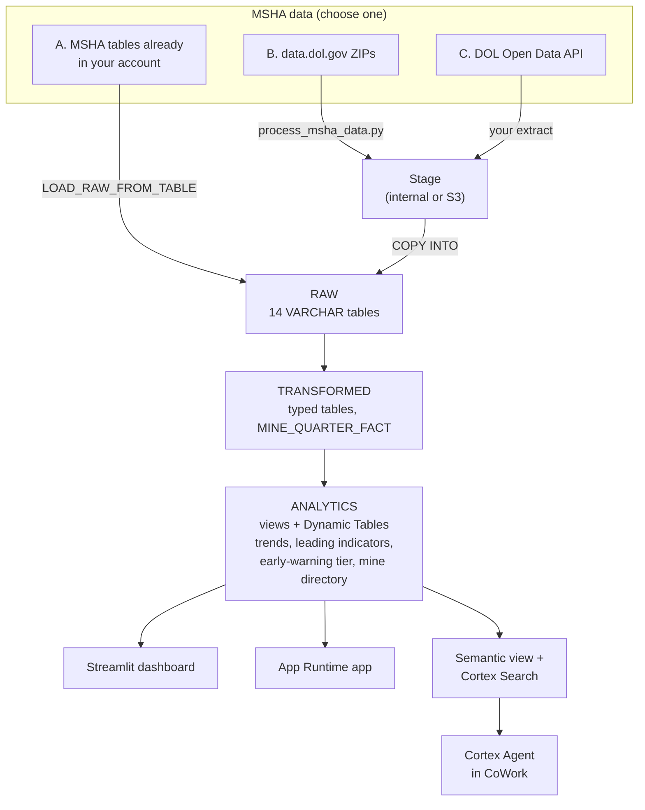

# MSHA Mine Safety Analytics on Snowflake

An end-to-end Snowflake demo built on public Mine Safety and Health Administration (MSHA) data from the [DOL Open Data Portal](https://data.dol.gov/). It loads 14 MSHA datasets, builds a mine-by-quarter safety model, and puts it in front of three audiences:

| Layer | Object | Question it answers | Users |
|---|---|---|---|
| Dashboard | `DOL_MSHA_DEMO.APPS.MSHA_SAFETY_DASHBOARD` (Streamlit in Snowflake) | Where and why are miners hurt, and which leading indicators separate risk? | Analysts, leadership |
| App | `DOL_MSHA_DEMO.APPS.MSHA_EARLY_WARNING_APP` (Snowflake App Runtime, Next.js) | What is the risk at *this* mine, and which mines should we visit first? | Inspectors, supervisors |
| Agent | `DOL_MSHA_DEMO.APPS.MSHA_SAFETY_AGENT` (Cortex Agent in Snowflake CoWork) | Anything, in plain English, with a cited answer | Anyone, no SQL |

## About the data (read this first)

- **Portal data only.** Everything comes from the DOL Open Data Portal. Nothing is synthetic.
- **Rates** are pooled per 200,000 operator hours: `SUM(operator injuries) * 200000 / SUM(operator hours)`. Per-mine rates are never averaged.
- **Coverage** is 2010 to 2026 Q2. **2026 is a partial year** and is left out of year-over-year comparisons.
- **The early-warning tier** (Elevated, Watch, Typical) is an illustrative signal built from public citations and injuries. It is not an official MSHA rating and not a prediction for any mine.
- **Accident narratives** are truncated at 384 characters by the portal.
- **Fatality counts** include operator and contractor employees. Mine history is attributed to the mine's current operator.

## Architecture



| Schema | Contents |
|---|---|
| `RAW` | One all-VARCHAR table per portal dataset, loaded as-is |
| `TRANSFORMED` | Typed, cleaned tables and `MINE_QUARTER_FACT` (one row per mine per quarter) |
| `ANALYTICS` | Views and Dynamic Tables used by the apps: `NATIONAL_TRENDS`, `STATE_TRENDS`, `HAZARD_TRENDS`, `MINE_QUARTER_TRENDS`, `ACCIDENT_DETAIL`, `VIOLATION_DETAIL`, `LEADING_INDICATORS`, `MINE_DIRECTORY`, `MINE_EARLY_WARNING`, `PENALTY_OUTCOMES`, the semantic view and the search service |
| `APPS` | Streamlit dashboard, App Runtime app, Cortex Agent |

## Repository layout

| Path | What it is |
|---|---|
| `process_msha_data.py` | Reads the portal ZIPs, filters fact tables to 2010+, writes gzip CSVs to `output/` (or S3 with `--target s3`), writes `data/manifest.json` |
| `sql/01_setup.sql`, `sql/02_raw_tables.sql` | Role, warehouse, database, schemas, the 14 RAW tables |
| `sql/03a_put_files.sql`, `sql/03_load.sql` | Option B: upload the extracts to an internal stage (or point at S3) and `COPY INTO` RAW |
| `sql/03b_load_from_existing_tables.sql` | Option A: fill RAW from MSHA tables already in your account |
| `sql/04_verify.sql` | Load checks: counts, date ranges, join coverage |
| `sql/05_transformed_tables.sql` - `sql/08_eda_queries.sql` | Transformation, mine-quarter fact, analytical views, exploratory queries |
| `sql/09_streamlit_setup.sql`, `sql/10_dashboard_views.sql` | Dashboard schema and support view |
| `sql/11_app_views.sql` | Dynamic Tables behind the app (early-warning tier, mine directory, peer benchmarks) |
| `sql/12_semantic_view.sql` | Semantic view `MSHA_SAFETY_SEMANTIC_VIEW` with 11 verified queries |
| `sql/13_cortex_search.sql` | Cortex Search service `ACCIDENT_NARRATIVE_SEARCH` over accident narratives |
| `sql/14_agent.sql` | Cortex Agent `MSHA_SAFETY_AGENT` and CoWork registration |
| `streamlit/` | Streamlit in Snowflake dashboard (4 pages) |
| `react-app/` | Next.js app for Snowflake App Runtime (see `react-app/README.md`) |
| `prompts/` | The Cortex Code prompts used to build each phase (see `prompts/README.md`) |

## Reproduce it in your account

### Prerequisites

- A Snowflake account with Cortex AI features (Cortex Analyst, Cortex Search, Cortex Agents), Streamlit in Snowflake (container runtime), Snowflake App Runtime and Snowflake CoWork. See **Feature availability** below.
- `ACCOUNTADMIN` (or equivalent) for the one-time setup steps: creating the role, warehouse and database, the PyPI integration grant, and the CoWork registration.
- The [Snowflake CLI](https://docs.snowflake.com/en/developer-guide/snowflake-cli/index) (`snow`) with a named connection.
- Python 3.11+ if you load from portal ZIPs (no extra packages; `boto3` only for the S3 option).
- Node.js 20+ if you want to run the app locally.

### Feature availability

The phases build on each other but degrade cleanly. If a feature is not available in your account or region (for example some government regions), you can stop at the last phase that works:

| Phase | Needs |
|---|---|
| Data + SQL (`sql/01`-`sql/11`) | Any Snowflake account. Dynamic Tables |
| Dashboard | Streamlit in Snowflake container runtime, a compute pool, a PyPI external access integration |
| App | Snowflake App Runtime (`snow app`) |
| Agent | Semantic views, Cortex Search, Cortex Agents, Snowflake CoWork, and an LLM available to Cortex in your region |

Check the Snowflake documentation for your region before planning a demo around a phase.

### Values to change

Nothing in this repo is tied to a particular account except these placeholders:

| Placeholder | Where | Replace with |
|---|---|---|
| `<YOUR_USER>` | `sql/01_setup.sql` | The user(s) who should get `DOL_MSHA_DEMO_ROLE` |
| `<SOURCE_DB>.<SOURCE_SCHEMA>.<...>` | `sql/03b_load_from_existing_tables.sql` | Your existing MSHA tables (Option A only) |
| `<your-bucket>`, `<your_s3_integration>` | `sql/01_setup.sql`, `sql/03_load.sql` (commented) | Only for the S3 option |
| `PYPI_ACCESS_INTEGRATION` | `streamlit/snowflake.yml`, `sql/09_streamlit_setup.sql` | Your PyPI external access integration |
| `SYSTEM_COMPUTE_POOL_CPU` | `streamlit/snowflake.yml` | A compute pool the role can use |
| `DASHBOARD_URL` | `react-app/lib/constants.ts` | Your dashboard's Snowsight URL (after Step 3) |
| `<connection>` | commands in this README | Your `snow` connection name |

Object names (`DOL_MSHA_DEMO`, `DOL_MSHA_WH`, `DOL_MSHA_DEMO_ROLE`) can stay as they are. If you rename them, search the whole repo: the SQL, `streamlit/snowflake.yml`, `react-app/app.yml` and the app's queries all use them.

### Step 1: Get the data into RAW

> **Already have MSHA data in Snowflake?** Skip the download and file-loading steps (Options B and C). Run `01_setup.sql` and `02_raw_tables.sql`, then Option A to map your existing tables into RAW, and go straight to Step 2.

Every later step reads only the 14 `RAW.MSHA_*` tables, so pick whichever source suits you. Start with:

```bash
C=<your-connection>
snow sql -c $C -f sql/01_setup.sql          # as ACCOUNTADMIN
snow sql -c $C -f sql/02_raw_tables.sql
```

**Option A: MSHA tables already in your Snowflake account.** If your account already holds MSHA data from the portal, point `sql/03b_load_from_existing_tables.sql` at those tables and run it. A procedure copies every column whose name matches the portal name, casts it to text, and applies the same 2010+ filter to fact tables. It reports matched and missing columns per table. Column names must match the portal headers (`MINE_ID`, `AI_DT`, `VIOL_NO`, and so on); if yours differ, rename them in a view first.

```bash
snow sql -c $C -f sql/03b_load_from_existing_tables.sql
```

**Option B: Download from the DOL Open Data Portal.** On each dataset's page at [data.dol.gov](https://data.dol.gov/datasets?filterBy=agency&name=Mine%20Safety%20and%20Health%20Administration), choose **Download Complete Dataset** and save the ZIP in `data/` as `MSHA_<api_name>.zip` (the portal's own file name). Then:

```bash
python3 process_msha_data.py                 # all datasets; --only accident,mines for a subset
snow sql -c $C -f sql/03a_put_files.sql      # upload output/msha-raw/ to the internal stage
snow sql -c $C -f sql/03_load.sql            # COPY INTO the RAW tables
```

To land the files in S3 instead, run `MSHA_S3_BUCKET=<bucket> python3 process_msha_data.py --target s3`, then use the commented S3 stage in `sql/03_load.sql` (it needs a storage integration, see `sql/01_setup.sql`).

**Option C: The DOL Open Data API.** Every dataset is also available through the DOL API (`https://apiprod.dol.gov/v4/get/MSHA/<api_name>/json`, free API key from data.dol.gov). Page through it with your tool of choice, write files with the portal column names, and load them with `sql/03_load.sql`, or land them in tables and use Option A.

The 14 datasets, with the rows kept in the original build:

| `api_name` | Portal dataset | Rows kept (2010+ for facts) |
|---|---|---|
| `accident` | Accident (10341) | 126,171 |
| `mines` | Mines (10350) | 92,102 |
| `inspection` | Inspection (10349) | 671,793 |
| `violation` | Violation (10355) | 1,787,409 |
| `assessed_violations` | Assessed Violations (10343) | 3,597,464 |
| `operator_employment_production_quarterly` | Operator Employment / Production, Quarterly (10353) | 1,667,657 |
| `operator_employment_production_annual` | Operator Employment / Production, Annual (10348) | 395,952 |
| `contractor_employment_production_quarterly` | Contractor Employment / Production, Quarterly (10354) | 908,704 |
| `contractor_employment_production_annual` | Contractor Employment / Production, Annual (10345) | 180,505 |
| `operator_history_at_mines` | Operator History at Mines (10352) | 136,043 |
| `contractor_history_at_mines` | Contractor History at Mines (10351) | 141,821 |
| `controller_history` | Controller History (10359) | 78,632 |
| `contractor_name_id_lookup` | Contractor Name ID Lookup (10344) | 91,067 |
| `commodity_lookup` | Commodity Lookup (10360) | 128 |

Counts are from the portal snapshot of November 2026 (`data/manifest.json`). The portal updates weekly, so yours will differ.

### Step 2: Build the database

Run the remaining SQL scripts in order. Every script is rerunnable (`CREATE OR REPLACE` / `IF NOT EXISTS`).

```bash
snow sql -c $C -f sql/04_verify.sql         # load checks (manifest comparison applies to Option B)
snow sql -c $C -f sql/05_transformed_tables.sql
snow sql -c $C -f sql/06_mine_quarter_fact.sql
snow sql -c $C -f sql/07_analytical_views.sql
snow sql -c $C -f sql/09_streamlit_setup.sql
snow sql -c $C -f sql/10_dashboard_views.sql
snow sql -c $C -f sql/11_app_views.sql
```

`sql/08_eda_queries.sql` is optional exploration and creates nothing.

### Step 3: Deploy the dashboard

One-time, as `ACCOUNTADMIN`: grant the demo role usage on your PyPI external access integration (see `sql/09_streamlit_setup.sql`). The container runtime installs packages from `pyproject.toml` at startup.

```bash
cd streamlit
snow streamlit deploy --replace --role DOL_MSHA_DEMO_ROLE -c $C
```

To run it locally, copy `streamlit/.streamlit/secrets.toml.example` to `secrets.toml` (git-ignored), fill in your account, and run `streamlit run Overview.py`.

After it deploys, copy the dashboard's Snowsight URL into `DASHBOARD_URL` in `react-app/lib/constants.ts` so the app links to it.

### Step 4: Deploy the app

See `react-app/README.md` for local development and tests. To deploy to Snowflake App Runtime from `react-app/`:

```bash
snow app deploy -c $C --role DOL_MSHA_DEMO_ROLE
```

`react-app/app.yml` sets the database (`DOL_MSHA_DEMO`), schema (`APPS`) and warehouse. Deploys take about 2 minutes.

### Step 5: Create the agent

Use `--enable-templating NONE`: the semantic view and agent text contain characters (such as `S&S`) that the CLI otherwise treats as template syntax.

```bash
snow sql -c $C --enable-templating NONE -f sql/12_semantic_view.sql
snow sql -c $C --enable-templating NONE -f sql/13_cortex_search.sql   # builds the index, a few minutes
snow sql -c $C --enable-templating NONE -f sql/14_agent.sql           # last statement needs ACCOUNTADMIN
```

The last statement of `14_agent.sql` adds the agent to CoWork:

```sql
ALTER SNOWFLAKE INTELLIGENCE SNOWFLAKE_INTELLIGENCE_OBJECT_DEFAULT
  ADD AGENT DOL_MSHA_DEMO.APPS.MSHA_SAFETY_AGENT;
```

Users also need `USAGE` on the CoWork object and a role that can use the agent, semantic view, search service and warehouse.

Then open [https://ai.snowflake.com](https://ai.snowflake.com) and pick **MSHA Mine Safety Agent**.

Sample questions to try:

- Which coal mines in District C04 had the most ventilation citations last year?
- What is the coal operator injury rate by year since 2015?
- Which Elevated mines are in Kentucky?
- Top 10 operators by fatalities since 2020
- How many 104(d)/107(a) actions were issued in West Virginia in 2025?
- Compare injury rates for underground vs surface coal mines
- Find roof-fall accidents involving continuous miners
- Show fatal accidents involving powered haulage in 2025
- What were methane levels at Oak Grove Mine last month? (the agent explains the data gap and offers the citation proxy)

### Step 6: Check it works

- **Dashboard:** the Overview page shows national trends from 2010 to 2026, with 2026 marked partial.
- **App:** `/architecture` shows live row counts for every layer and finds the semantic view, search service and agent.
- **Agent:** try the sample questions below. To test from SQL:

```sql
SELECT SNOWFLAKE.CORTEX.DATA_AGENT_RUN('DOL_MSHA_DEMO.APPS.MSHA_SAFETY_AGENT',
  $${"messages":[{"role":"user","content":[{"type":"text","text":"How many 104(d)/107(a) actions were issued in West Virginia in 2025?"}]}],"stream":false}$$);
```

## Cost

Everything runs on one X-Small warehouse (`DOL_MSHA_WH`, 60-second auto-suspend). Dynamic Tables and the search service refresh weekly (`TARGET_LAG = '7 days'`). The dashboard runs on a shared container compute pool, and the app on Snowflake App Runtime. Suspend the warehouse or drop the `APPS` objects when the demo is not in use.

## Known limitations

- The partial-year flag in the semantic view is fixed at 2026 (`YEAR >= 2026`). Update it when a new year of data loads.
- MSHA injury definitions follow the portal fields used in `sql/05` and `sql/06` and have not been reconciled against MSHA's published statistics.
- Penalty outcomes compare paid dollars with proposed and assessed dollars (about 70% of proposed and 86% of assessed in the November 2026 snapshot). Assessment lowers proposed penalties to about 81% of the original amount.
- `ACCIDENT_DETAIL` has one row per accident document.

## Tear down

```sql
USE ROLE ACCOUNTADMIN;
DROP DATABASE IF EXISTS DOL_MSHA_DEMO;   -- removes every table, view, app, search service and agent
DROP WAREHOUSE IF EXISTS DOL_MSHA_WH;
DROP ROLE IF EXISTS DOL_MSHA_DEMO_ROLE;
```

## Source and license

Data: U.S. Department of Labor, Mine Safety and Health Administration, via the DOL Open Data Portal (https://data.dol.gov/). Data downloaded from the portal is not stored in this repo.

Code: Apache License 2.0 (see `LICENSE`).

This is a demonstration built by Snowflake on public data. It is not an official DOL or MSHA product, the early-warning tier is illustrative, and figures should be checked against MSHA's published statistics before they are used for decisions. Provided as-is, without warranty or support.
